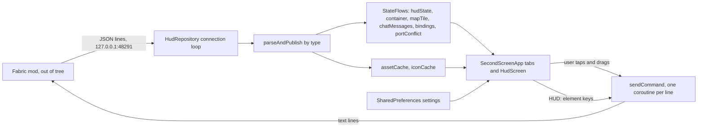
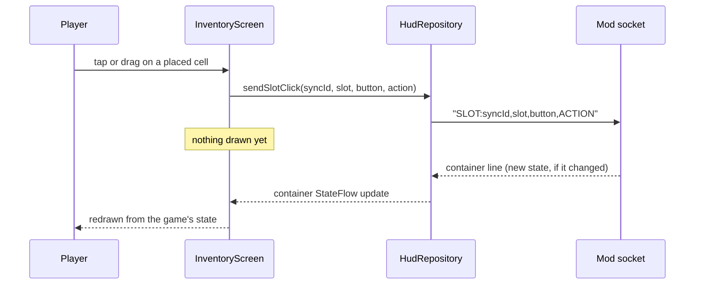
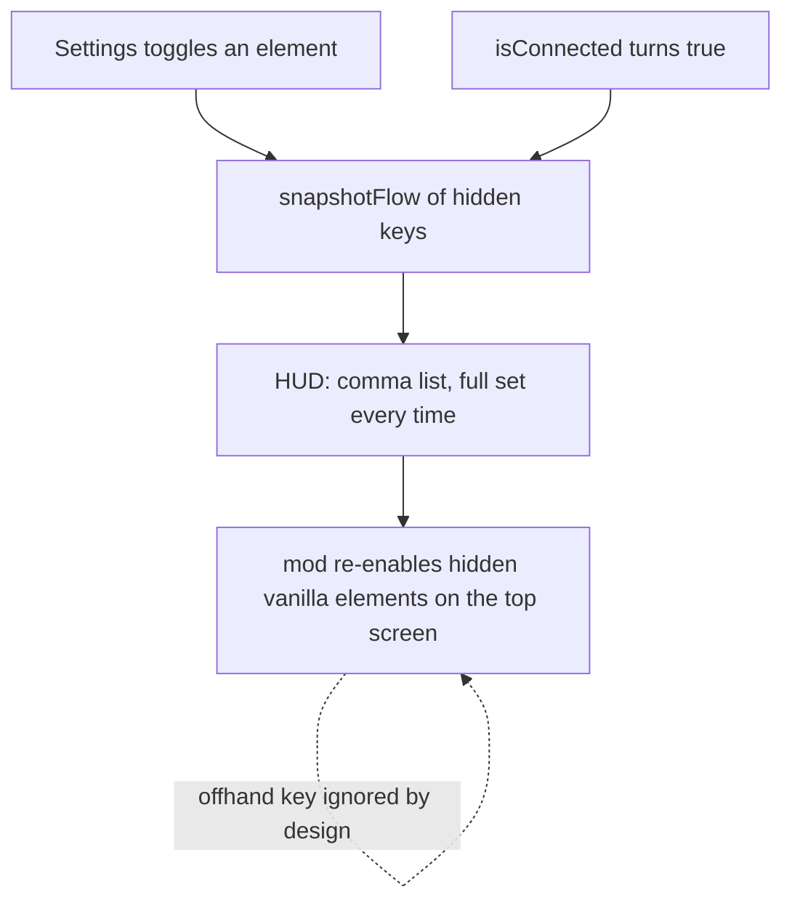
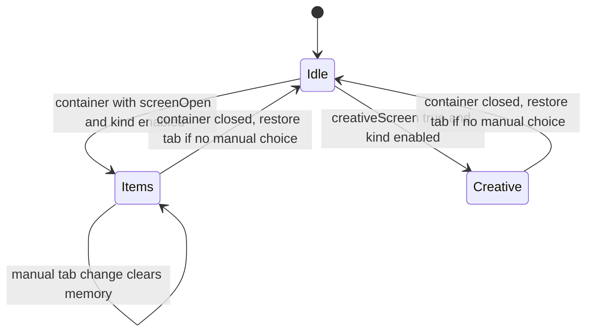
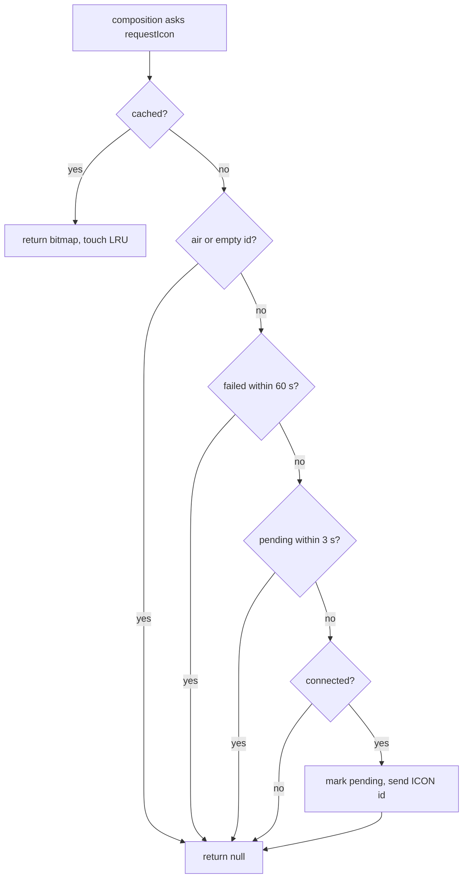

# 03 - Data flow

Diagrams are Mermaid. Labels containing parentheses or colons are quoted. The mod's internals are shown only as far as this tree observes them.

## End-to-end



## Connect and hello

```mermaid
sequenceDiagram
  participant App as Android HudRepository
  participant Mod as Mod socket
  App->>Mod: connect 127.0.0.1:48291 (1000 ms timeout)
  alt connection accepted
    Mod-->>App: hello (mod, protocol)
    Note over App: sawHello true, silent count 0, failed count 0, portConflict false
    Mod-->>App: asset lines (one per catalogue key)
    Mod-->>App: bindings line
    Mod-->>App: chat backlog lines
    Mod-->>App: container line (if a handler is open)
    loop each tick
      Mod-->>App: snapshot line (no type)
      Mod-->>App: map line
    end
    App->>Mod: HUD elements line (HUD:...)
    App->>Mod: CREATIVE, ICON, BINDINGS as requested
  else refused or closed without hello
    Note over App: silent count +1; after 3, portConflict true
    App->>App: wait by ReconnectPolicy, then retry
  end
```

The order of asset, bindings, chat and container lines follows the simulator's replay order (`tools/hud_sim.py:865-881`) and is **unverified** against the real mod.

## Container click round trip



## HUD element handoff



The HUD key list is sent whenever the connection comes up and whenever a toggle changes (`KT/SecondScreenApp.kt:215-219`). The mod's reaction is documented in `CLAUDE.md` and **unverified** here.

## Container takeover



Kind is `ContainerKind.of(handlerType, isPlayerInventory, creativeScreen)` (`KT/settings/ContainerKind.kt:83-97`). Creative always maps to the Inventory kind for its toggle (`:93`).

## Icon request


